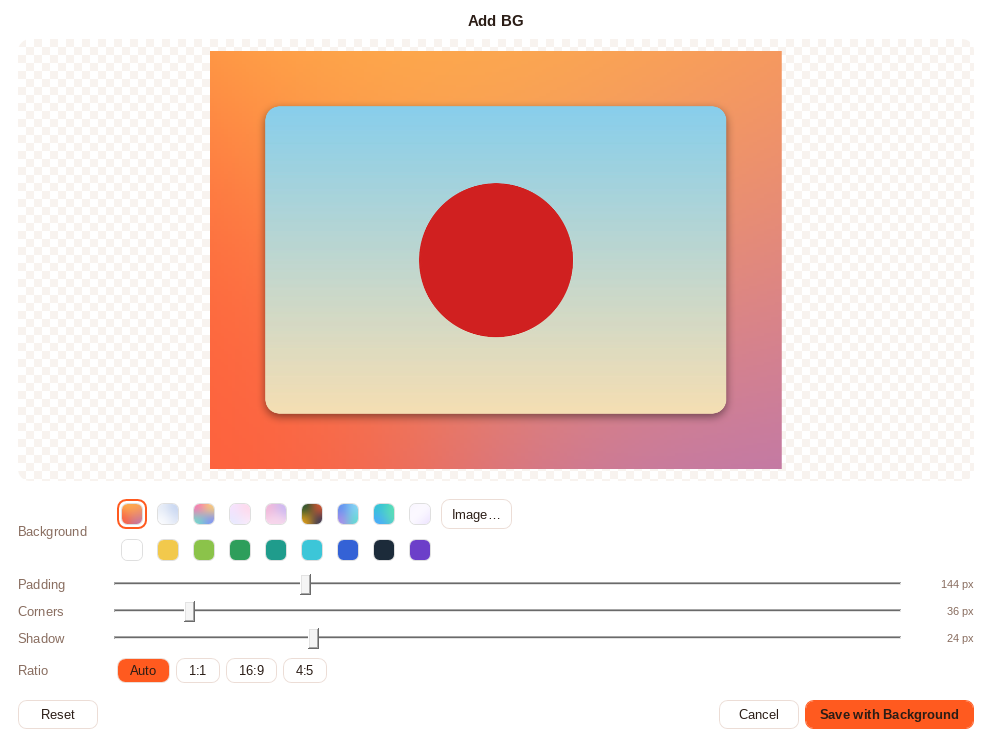

<p align="center"></p>

# DragShift for Windows

Drag a file, hold **Shift**, and a wheel pops up under the cursor. Drop on a format to convert, or on a tool to edit.
The result is saved next to the original, and the original is never touched.

<p align="center"></p>

## Using it

1. Run `DragShift.exe`. It sits in the system tray.
2. In File Explorer or on the desktop, start dragging one or more files.
3. Keep the mouse button down and press **Shift**. The wheel appears under the cursor.
4. Drop on a slice. Converted and edited files show up in the same folder, e.g. `Photo.webp` or `Page 001 Cropped.jpg`.
   A card in the corner shows the result, with **Show in folder**.

No Shift handy? Left-click the tray icon (or choose **Open the wheel**) and drag files onto it normally.

### Outer ring: convert

| | Notes |
|---|---|
| **PNG, JPG, WEBP, AVIF, BMP, TIFF** | Any image → any of these. Animated GIFs keep their frames in WEBP/TIFF. JPG/BMP get a white background where the source was transparent. |
| **HEIC** | Uses Windows' own HEIF encoder. DragShift checks at startup whether this PC can really write HEIC (Microsoft's free *HEIF Image Extensions* + *HEVC Video Extensions*); if not, the HEIC slice is greyed out and says why. |
| **PDF** | Images → PDF (multi-frame files become multi-page PDFs). |
| **DOCX** | **PDF → editable Word text**: paragraphs in reading order (multi-column aware), font sizes, bold/italic, headings, hyphenated line breaks re-joined, and embedded images in place. Scanned pages (no text layer) come in as a picture of the page. Images → DOCX places each image on its own page. Tables and exact positioning aren't reproduced; text flows as paragraphs. |

PDFs can be dropped too: they're rendered with Windows' built-in PDF engine, one image per page (or one multi-page TIFF).

### Inner ring: tools (images)

| Tool | What it does |
|---|---|
| **Compress** | Smaller file, same format (PNG/BMP/TIFF become JPG, or a 256-color PNG if transparent). Caps the long side at 2560 px and strips metadata. Skips files it can't shrink. |
| **Metadata** | Removes EXIF (camera, GPS location, …), XMP, IPTC and other profiles. Orientation is baked into the pixels first. |
| **Remove BG** | Cuts out the main subject with a small on-device AI model (U²-Net). Saves a transparent PNG. Nothing is uploaded. |
| **Crop…** | Drag the box or its handles. Free, original, 1:1, 4:5, 16:9 and 9:16. |
| **Redact…** | Drag boxes over anything sensitive: black box, pixelate or blur. |
| **Annotate…** | Pen, highlighter and eraser in 8 colors. |
| **Edit…** | Rotate, flip, brightness, contrast, saturation, resize. |
| **Add BG…** | Places the picture on a gradient, color or photo, with padding, rounded corners, a soft shadow and Auto / 1:1 / 16:9 / 4:5 framing. |

<p align="center"></p>

### Tray menu

- **Shift + drag opens the wheel**: master on/off.
- **Only for drags from Explorer and the desktop** (default on): so Shift-dragging to select text in other apps isn't
  interrupted. Turn it off to get the wheel for drags from any app.
- **Start with Windows**.
- **Open-source licenses**: shows the license texts of everything bundled.

## Download

Grab `DragShift.exe` from the latest [release](../../releases) (or from the `DragShift-win-x64` artifact of a CI run).
It's a single self-contained file for 64-bit Windows 10/11: no .NET install needed. Windows SmartScreen may warn
because the exe isn't code-signed. Choose **More info → Run anyway**.

## Building

Requires the .NET 8 SDK. Builds on Windows, and on Linux/macOS too (the UI is code-only WPF; run it on Windows).

```sh
dotnet test tests/DragShift.Core.Tests            # conversions and tools (cross-platform)
dotnet publish src/DragShift.App -c Release -r win-x64 --self-contained true \
  -p:PublishSingleFile=true -p:IncludeNativeLibrariesForSelfExtract=true \
  -p:EnableCompressionInSingleFile=true -p:DebugType=none -o publish
```

`DragShift.exe --smoke-test <folder>` opens the wheel and every editor on a sample image, saves screenshots and
exercises each save path. CI runs it on every push.

### Layout

- `src/DragShift.Core`: formats, conversions, tools, background rendering/removal (Magick.NET, ONNX Runtime). No UI.
- `src/DragShift.App`: tray app: global mouse hook (`DragWatcher`), the wheel (`WheelWindow`), editors, toasts, and
  Windows-only services (PDF via `Windows.Data.Pdf`, HEIC via WIC).
- `tests/DragShift.Core.Tests`: xUnit tests for the core.

## How the Shift+drag works

A low-level mouse hook notices a left-button drag that started in Explorer or on the desktop. When Shift is held during
it, a borderless, non-activating, topmost window (the wheel) is shown centered on the cursor. Since the system drag is
still in progress, the wheel is simply a drop target: Windows delivers the files to whichever slice you release on.
Results are always written as new files; DragShift never moves, renames or overwrites your files.

## License

DragShift is open source under the [MIT License](LICENSE). It bundles other open-source components (Magick.NET /
ImageMagick and its codecs, ONNX Runtime, PdfPig, the U²-Net model, the .NET runtime); see
[THIRD-PARTY-NOTICES.md](THIRD-PARTY-NOTICES.md) and the full texts in [`licenses/`](licenses).
